# Memória Descritiva

## A PISTAS: Plataforma Inteligente de Stands Tolerante a Avarias do Sudeis

- **Nome completo do Aluno:** Muhammad Sudeis Abdul Latif Sacoor
- **Número de estudante:** 20241707
- **Curso/ Unidade curricular:** Licenciatura em Engenharia Informática (L-EI) / Projeto de Desenvolvimento de Software
- **Ano curricular/ Semestre:** 3.º ano / 5.º semestre (2026/2027)
- **Docentes Projeto Multidisciplinar:** Rui Pascoal e Miguel Boavida (Projeto de Desenvolvimento de Software); Rui Ramos (Engenharia de Software); Sérgio Nunes e Pedro Brandão (Segurança Informática); Pedro Rosa (Sistemas Distribuídos); Samuel Gomes (Inteligência Artificial)

*Relatório final, 2.ª versão (2.ª entrega), 15 de novembro de 2026.*

## Resumo

Num aeroporto, cada avião estacionado ocupa um stand, o lugar marcado onde embarca e desembarca passageiros. Dois aviões não podem ocupar o mesmo stand ao mesmo tempo, mas a coordenação entre as empresas envolvidas depende de comunicação entre elas, e um erro gera atrasos. A PISTAS é uma aplicação web para reservar e gerir os stands do Aeroporto de Lisboa (LPPT). O utilizador principal é o despachante, a pessoa de uma companhia aérea que planeia os voos e pede o stand de cada um. Se o stand estiver livre e a aeronave couber, o pedido é aprovado na hora. Se for recusado, um solver de restrições (CSP) propõe até cinco stands alternativos. A ANA, que gere os aeroportos portugueses, revê o plano e pode remover alocações, e a companhia é avisada. O despachante pode pedir assistência em terra a um ground handler (Menzies, Portway), que só vê o pedido. Os controladores consultam o plano e reportam um stand incorreto, que aparece num aviso na página da ANA.

O desafio técnico está na parte "tolerante a avarias". A regra que nunca pode falhar é que um stand não tenha duas reservas sobrepostas, nem quando vários despachantes pedem ao mesmo tempo, nem quando parte do sistema falha. Por isso a regra é imposta pela própria base de dados, e um pedido repetido por engano não cria uma reserva duplicada.

Nesta 2.ª entrega a solução está implementada e é distribuída: um nginx com TLS reparte os pedidos por três backends FastAPI, que escrevem num cluster MariaDB Galera de três nós. A inteligência artificial é um solver CSP escrito de raiz, sem bibliotecas externas, com consistência de arco (AC-3), backtracking com MRV, forward checking e branch and bound. Ainda está em validação e não é totalmente fiável, por isso só propõe e nunca decide: a decisão final é da base de dados. A segurança inclui HTTPS, palavras-passe com Argon2id, permissões por papel verificadas no backend e limite de tentativas de início de sessão. Foram executados testes de faltas em que se matam contentores e nós da base de dados durante o uso: em nenhum dos cenários houve reservas duplicadas, e quando o cluster perde a maioria o sistema recusa escritas em vez de arriscar um erro. Faço o projeto sozinho, com dados reais dos stands do LPPT e voos e contas simulados.

## 1. Contexto/ Introdução

### 1.1. Problema abordado

Um stand é o lugar do aeroporto onde um avião fica parado. Só pode haver um avião de cada vez em cada stand, e várias entidades (companhias, a ANA, empresas de assistência em terra) precisam de saber o que está ocupado e quando. Se duas reservas se sobrepõem, o resultado são atrasos e trabalho de correção à última hora.

O problema técnico é garantir no máximo uma reserva por stand em cada intervalo de tempo, mesmo com vários utilizadores a pedir ao mesmo tempo e com partes do sistema a falhar.

### 1.2. Motivação

Escolhi um tema de aviação porque é a área da minha vida. Futuramente, pretendo ser piloto comercial, e obtive várias informações através de pilotos da TAP, Air Mozambique e um piloto da Etihad. O problema das reservas é também um bom exemplo real de sistemas distribuídos: tem concorrência, tem consistência de dados e tem consequências claras quando falha.

A minha ideia inicial era uma aplicação virada para pilotos. Percebi que o âmbito era demasiado complexo para um trabalho individual e que, na prática, os dados passam de empresa para empresa através dos despachantes. Por isso redesenhei a PISTAS para o despachante.

### 1.3. Objetivos

O objetivo geral é permitir reservar stands no LPPT sem conflitos e com tolerância a avarias. Os objetivos específicos, e o estado de cada um nesta entrega:

| Objetivo | Estado |
|---|---|
| Permitir ao despachante pedir um stand para um voo | Cumprido |
| Detetar conflitos e impedir reservas sobrepostas | Cumprido (regra na base de dados) |
| Aprovar automaticamente os pedidos sem conflito | Cumprido |
| Propor stands com um solver de restrições (CSP) | Parcial (solver próprio, ainda em validação) |
| A ANA revê o plano e remove alocações, com aviso à companhia | Cumprido |
| Pedido de ground handling visível para o handler | Cumprido |
| Controladores consultam o plano e reportam erros | Cumprido (o reporte aparece à ANA) |
| Autenticação, hash de palavras-passe e permissões por papel | Cumprido |
| Manter o serviço quando um nó falha | Cumprido e testado (T1 a T8) |

## 2. Processo

### 2.1. Metodologia utilizada

Desenvolvimento incremental, em duas fases, como previsto na 1.ª entrega. Na fase 1 construí o sistema completo num só nó, com a regra de não sobreposição validada antes de escrever o backend (um spike em InnoDB e em Galera). Na fase 2 distribuí o sistema por três backends e três nós de base de dados e testei falhas. Escolhi esta ordem para ter sempre uma versão a funcionar antes de acrescentar a complexidade da distribuição. As decisões ficam registadas por escrito em `04_Documentacao_Tecnica/`, e cada funcionalidade ficou registada em commits no GitHub.

### 2.2. Ferramentas utilizadas

Git e GitHub para o código e para o arquivo documental (https://github.com/oastghost/PISTAS), Markdown para a documentação, aplicações da JetBrains para escrever o código, Docker e Docker Compose para correr os componentes, e Mermaid para os diagramas.

### 2.3. Tecnologias utilizadas

| Camada | Tecnologia | Razão |
|---|---|---|
| Frontend | React, Vite, TypeScript | Um ecrã por perfil de utilizador |
| Balanceador e TLS | nginx 1.27 | O mais simples de configurar; termina o TLS e reencaminha pedidos falhados |
| Backend | Python 3.12, FastAPI, em 3 contentores Docker | Sem estado, qualquer instância serve qualquer pedido |
| Base de dados | MariaDB 11.4 em cluster Galera de 3 nós | Replicação síncrona e maioria (quórum) para decidir em caso de falha |
| IA | Solver CSP próprio em Python (`csp.py`, `solver.py`), em validação | Escrito de raiz, só com a biblioteca standard |
| Segurança | Argon2id, JWT, TLS 1.2/1.3, limite de pedidos no nginx | Ver secção 3.1 |
| Contentores | Docker e Docker Compose | Correr frontend, 3 backends, nginx e 3 nós da base de dados |

Escolhi a MariaDB porque já trabalhei com ela e com o MySQL. O Galera replica os dados entre nós, e três nós dão maioria para decidir em caso de falha. Na 1.ª entrega admiti usar o OR-Tools para o solver; acabei por escrever o solver de raiz para controlar e explicar cada técnica usada.

### 2.4. Estrutura da equipa

O trabalho é individual e foi aprovado pelos docentes. Sou o responsável por toda a conceção, desenvolvimento, testes e documentação. O histórico de commits no GitHub é o registo do meu contributo.

## 3. Resultados

### 3.1. Descrição da solução desenvolvida

**Arquitetura.** O browser fala apenas com o nginx, por HTTPS (Figura 9). O nginx termina o TLS, serve o frontend e reparte os pedidos `/api` por três backends idênticos e sem estado. Cada backend prefere um nó Galera diferente e passa para outro se este falhar. Os nós replicam de forma síncrona e só aceitam escritas enquanto tiverem a maioria (2 de 3). Os componentes e as suas ligações estão na Figura 10 e o modelo de dados na Figura 13.

**A regra principal.** A tabela `stand_block` tem uma linha por reserva ativa e a restrição `UNIQUE (stand_id, occupied WITHOUT OVERLAPS)`. O período ocupado inclui 30 minutos de espera entre voos. A base de dados recusa qualquer reserva que se sobreponha, seja qual for o backend que a enviou. Cada pedido traz um identificador gerado pelo cliente, por isso repetir um pedido devolve a mesma reserva e nunca cria outra. É isto que torna seguro o nginx reenviar um POST falhado para outro backend (Figuras 11 e 12). Quando dois nós aceitam pedidos sobrepostos ao mesmo tempo, o perdedor recebe o erro 1213 e o backend repete o pedido, por isso o despachante só vê uma recusa verdadeira.

**Tolerância a faltas.** Não há ponto único de falha: três backends e três nós. O nginx faz verificação de saúde passiva e reenvia pedidos falhados. O `/health` devolve 503 quando o backend não consegue escrever. Os testes T1 a T8 (Figura 14) matam backends e nós com `docker kill` durante o uso, isolam um nó da rede e matam dois nós de três. Os testes passaram, sem reservas duplicadas. O estado do cluster em cada situação está na Figura 2. Quando o cluster perde a maioria o sistema escolhe recusar escritas (503) a arriscar uma duplicação, e recupera sozinho quando os nós voltam. A queda dos três nós exige um procedimento de recuperação (`recover.ps1`), testado com os dados intactos.

**Inteligência artificial: solver CSP.** Cada voo é uma variável e o seu valor é um stand. As restrições unárias exigem que a aeronave caiba, que a ANA não tenha retirado esse stand ao voo e que ninguém o ocupe nesse período. A restrição binária proíbe dois voos sobrepostos no mesmo stand. O custo mínimo prefere o stand pedido, depois o mesmo apron, e poupa os stands grandes para aeronaves grandes. O motor (`csp.py`, 145 linhas) usa consistência de nó, AC-3, backtracking com MRV e grau, forward checking e branch and bound, e devolve as k melhores soluções de forma determinística. O solver ainda não é totalmente fiável: passa nos testes descritos, mas não os cobre todos, e continua em validação. Só propõe e nunca escreve na base de dados: quem decide é a base de dados, por isso um erro do solver nunca cria uma reserva duplicada. Foi testado em problemas clássicos (N-rainhas, coloração do mapa da Austrália), contra um oráculo simples em 150 cenários aleatórios sobre os 84 stands reais, e contra força bruta em 40 cenários.

**Segurança.**
- Dados em trânsito: HTTPS com TLS 1.2 e 1.3, redirecionamento de HTTP, HSTS e cabeçalhos `X-Content-Type-Options` e `X-Frame-Options`. O certificado é autoassinado (desenvolvimento).
- Palavras-passe guardadas só com Argon2id e sal aleatório, mínimo de 12 caracteres. O início de sessão faz o mesmo trabalho quando o utilizador não existe, para não revelar quais as contas que existem.
- Sessões com token JWT. O estado da conta é lido da base de dados em cada pedido, por isso uma conta desativada perde o acesso de imediato.
- Permissões por papel verificadas no backend. Cada despachante só pede voos com os prefixos da sua companhia e só vê os avisos da sua companhia.
- O nginx limita o início de sessão e a mudança de palavra-passe a 10 por minuto por endereço (resposta 429).
- Segredos em variáveis de ambiente, fora do repositório (só existe `.env.example`).
- Registo de auditoria de inícios de sessão, remoções pela ANA, criação e desativação de contas e redefinições de palavra-passe, sem guardar palavras-passe.

### 3.2. Funcionalidades principais

- Pedido de stand por voo, aeronave e período, com aprovação automática (Figura 4).
- Verificação de conflitos garantida pela base de dados.
- Até cinco stands alternativos propostos pelo solver CSP quando o pedido é recusado.
- Revisão do plano pela ANA, que só pode remover alocações (Figura 5).
- Aviso à companhia quando uma alocação é removida, com o contacto da ANA.
- Gestão de companhias, prefixos de voo e contas pelo supervisor da ANA, com registo de alterações (Figura 6).
- Primeiro início de sessão com mudança obrigatória de palavra-passe.
- Pedido de ground handling, visível para o handler (Figura 8), que atribui a equipa internamente.
- Vista do controlador com botão de reporte (Figura 7) e aviso na página da ANA.
- Início de sessão com permissões por papel (Figura 3).
- Funcionamento mantido quando um backend ou um nó da base de dados falha.

### 3.3. Contributos relevantes

- Redefini o âmbito: de uma aplicação para pilotos para uma ferramenta de despachantes, viável para um trabalho individual.
- A regra de não sobreposição é garantida na base de dados, e não só no código, e foi verificada num cluster Galera de três nós antes de escrever o backend.
- Escrevi um solver CSP de raiz e testei-o contra um oráculo e contra força bruta (ainda em validação).
- Os pedidos são idempotentes, o que torna seguro o reenvio automático entre backends.
- Executei os testes de faltas T1 a T8 contra a pilha completa e documentei os resultados, incluindo o comportamento sem maioria e o procedimento de recuperação total.
- Escrevi a documentação a pensar em quem não conhece aviação, com glossário (Anexo A).

## 4. Reflexão/ Conclusões

### 4.1. Lições aprendidas

Pôr a garantia na base de dados tornou o resto simples de raciocinar: os backends não precisam de coordenação entre si. Testar avarias a sério mostrou comportamentos que a teoria não prevê, como o erro 1213 numa corrida entre nós, ou o facto de uma queda abrupta custar a maioria enquanto uma paragem limpa não custa. Reduzir o âmbito cedo, ainda na 1.ª entrega, foi o que tornou possível chegar a um sistema distribuído testado sozinho.

### 4.2. Limitações

- O solver CSP ainda não é totalmente fiável: está em validação e a decisão final é sempre da base de dados.
- O despachante escolhe a aeronave numa lista limitada de tipos, e não por código de aeronave.
- Os alertas por e-mail estão em exploração e não fazem parte do que prometo.
- Assume-se que no máximo 1 dos 3 nós da base de dados falha ao mesmo tempo. Com dois nós em queda abrupta o sistema fica indisponível, por escolha.
- Todos os contentores correm na mesma máquina: não foram testadas latência nem perda de pacotes entre máquinas.
- Um nó sem maioria recusa também leituras; não há modo só de leitura em partição.
- A verificação de saúde do nginx é passiva e o certificado TLS é autoassinado.
- Os voos, as contas e as 8 equipas de handling são simulados; não há ligação a sistemas reais da ANA ou dos handlers.
- Não há recuperação de palavra-passe esquecida (só a supervisão a redefine).
- Sem interface para pilotos, sem mapa em tempo real, sem aplicação móvel e sem IoT.

### 4.3. Trabalho futuro

Para a 3.ª entrega: permitir ao despachante escolher a aeronave pelo código do tipo de aeronave, em vez de uma lista limitada, validar melhor o solver CSP, correr os nós em máquinas diferentes e medir latência e perdas de pacotes, verificação de saúde ativa, modo de leitura degradado numa partição, um certificado TLS válido e recuperação de palavra-passe. Fora do âmbito atual, mas possíveis: mapa em tempo real, aplicação móvel e interface para pilotos.

## 5. Imagens

Todas as imagens têm pelo menos 3000 px no maior lado, sem marcas de água e sem compressão excessiva. Estão em `02_Imagens/` (capturas e gráficos) e `04_Documentacao_Tecnica/diagramas/` (diagramas, com o código-fonte Mermaid).

### a) Processo de trabalho

N/A. O histórico de commits está no repositório GitHub.

### b) Conceitos

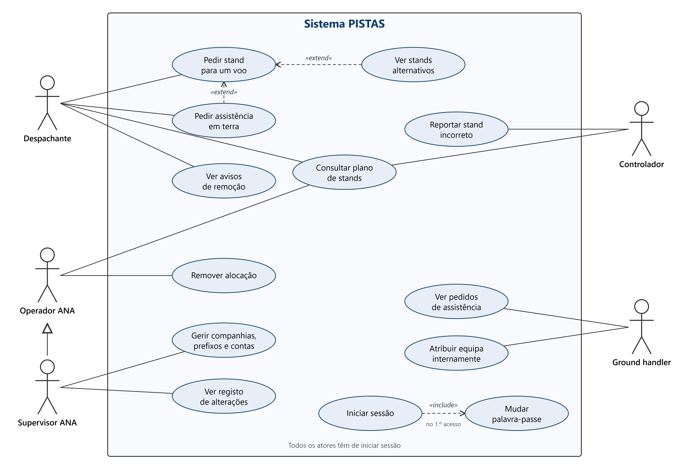
*Figura 1. Diagrama de casos de uso: atores e funcionalidades da PISTAS*

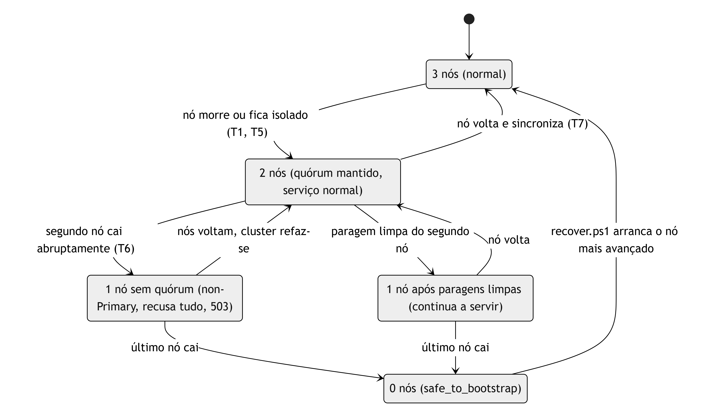
*Figura 2. Estados do cluster de base de dados e o que provoca cada transição*

### c) Protótipos e e) Mockups

N/A. A interface foi desenvolvida diretamente em código, primeiro contra uma API simulada e depois contra o backend real.

### d) Interfaces

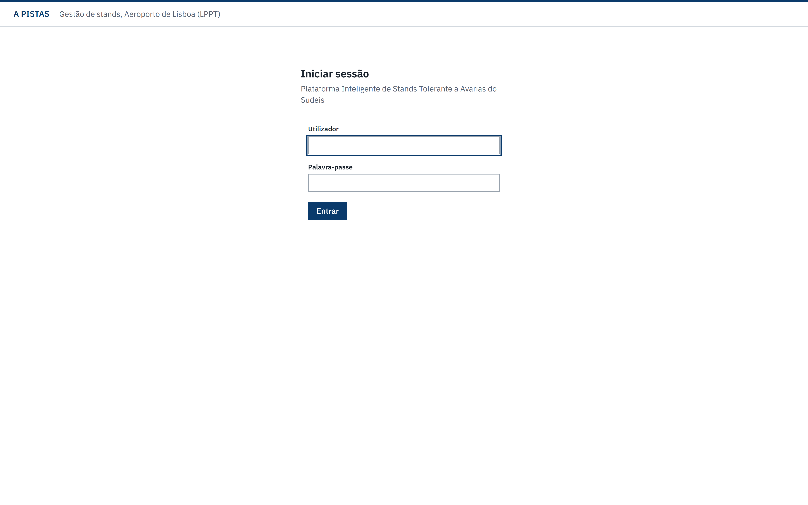
*Figura 3. Início de sessão*

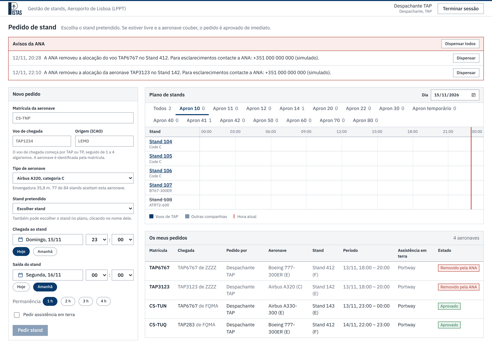
*Figura 4. Pedido de stand (despachante), com avisos da ANA, plano por hora e lista de pedidos*

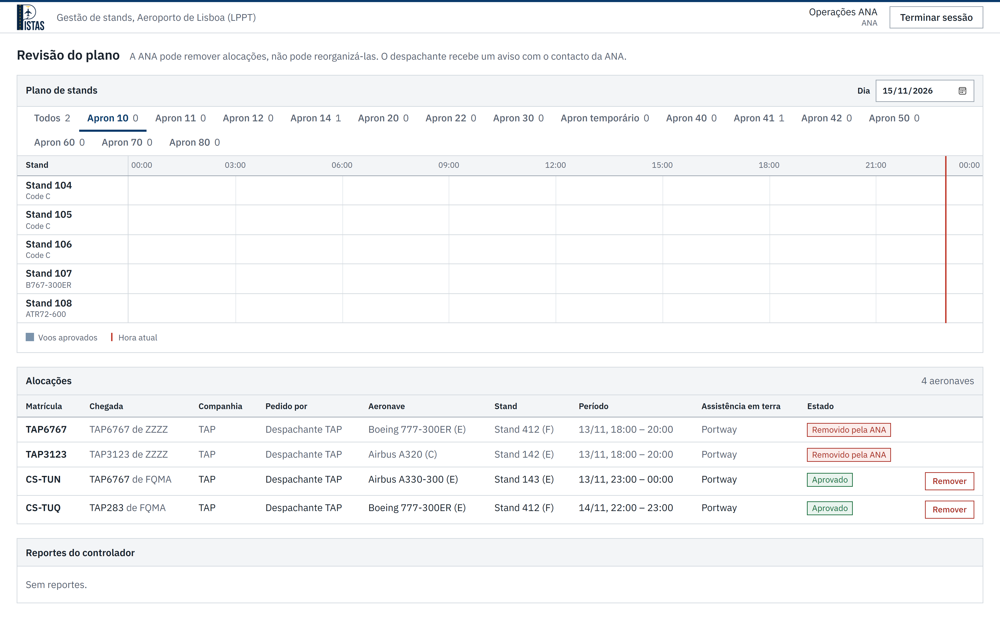
*Figura 5. Revisão do plano pela ANA, com alocações e botão de remover*

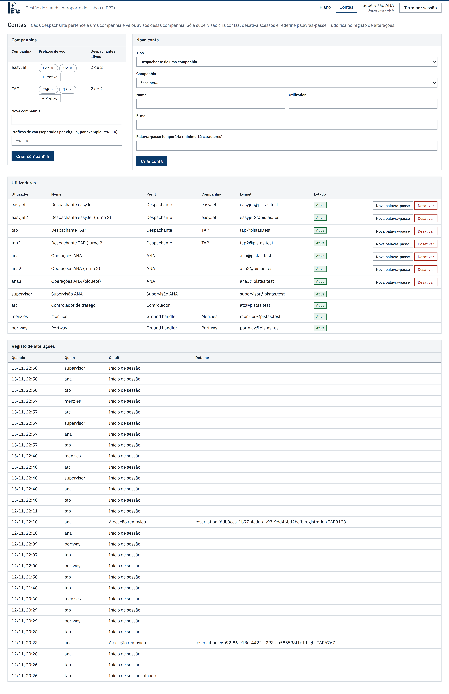
*Figura 6. Gestão de companhias, prefixos e contas (supervisor da ANA)*

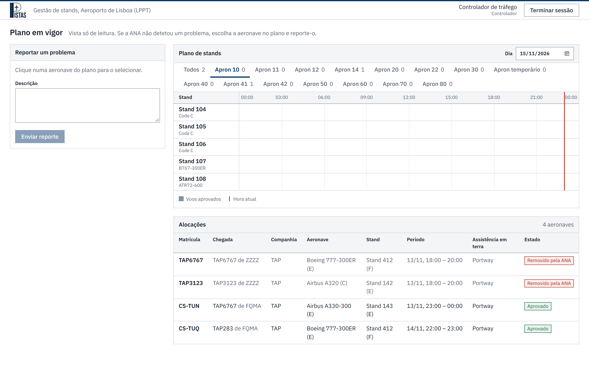
*Figura 7. Vista do controlador, com reporte de stand incorreto*

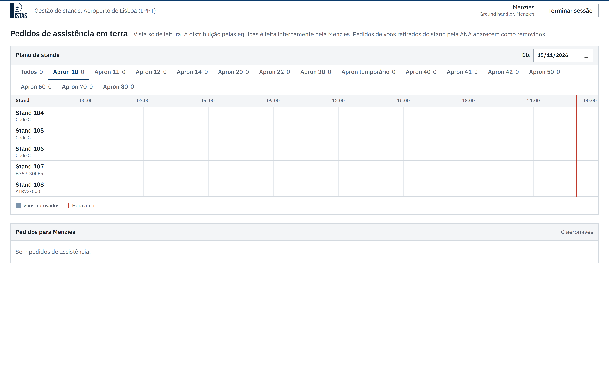
*Figura 8. Vista do ground handler, com os pedidos de assistência em terra*

### f) Artefactos produzidos

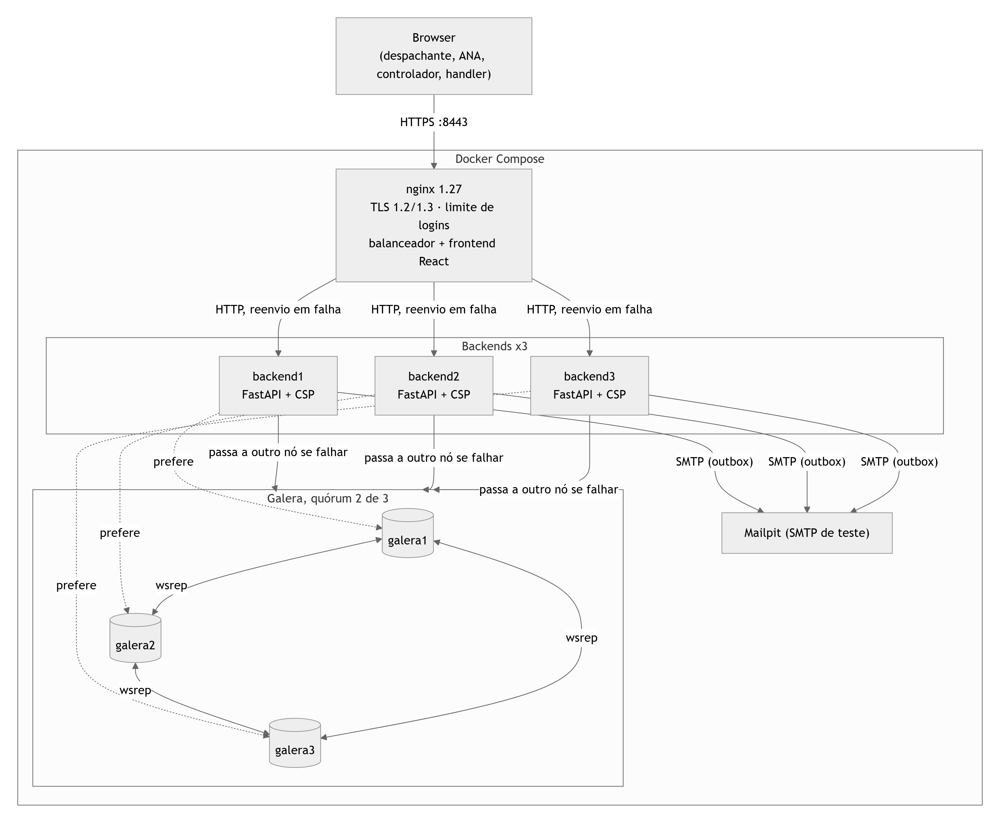
*Figura 9. Diagrama de implantação: nginx, 3 backends, cluster Galera de 3 nós*

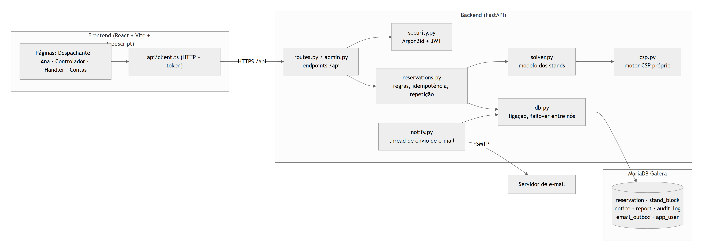
*Figura 10. Diagrama de componentes: frontend, backend (rotas, segurança, reservas, solver CSP) e base de dados*

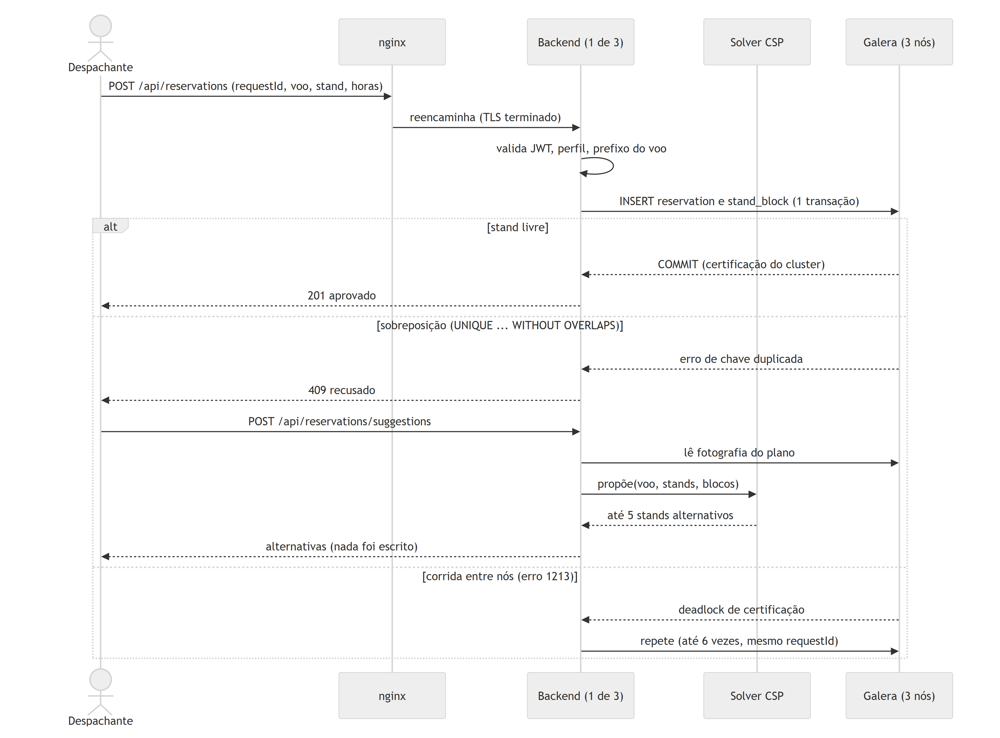
*Figura 11. Sequência de um pedido de stand: aprovação, recusa com alternativas e corrida entre nós*

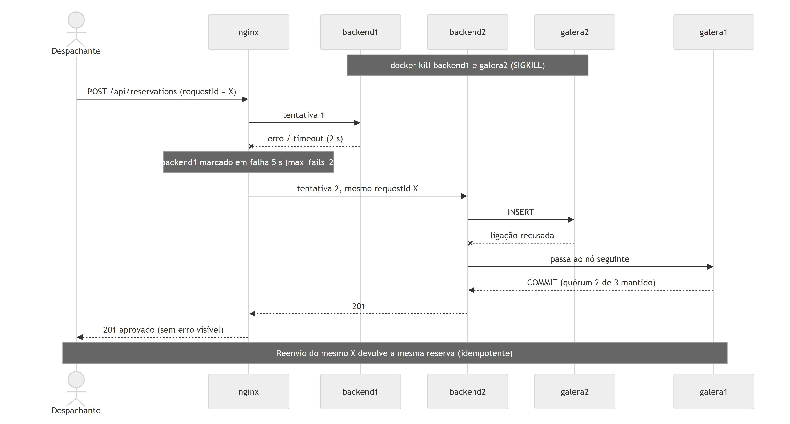
*Figura 12. Sequência com falha de um backend e de um nó da base de dados durante um pedido*

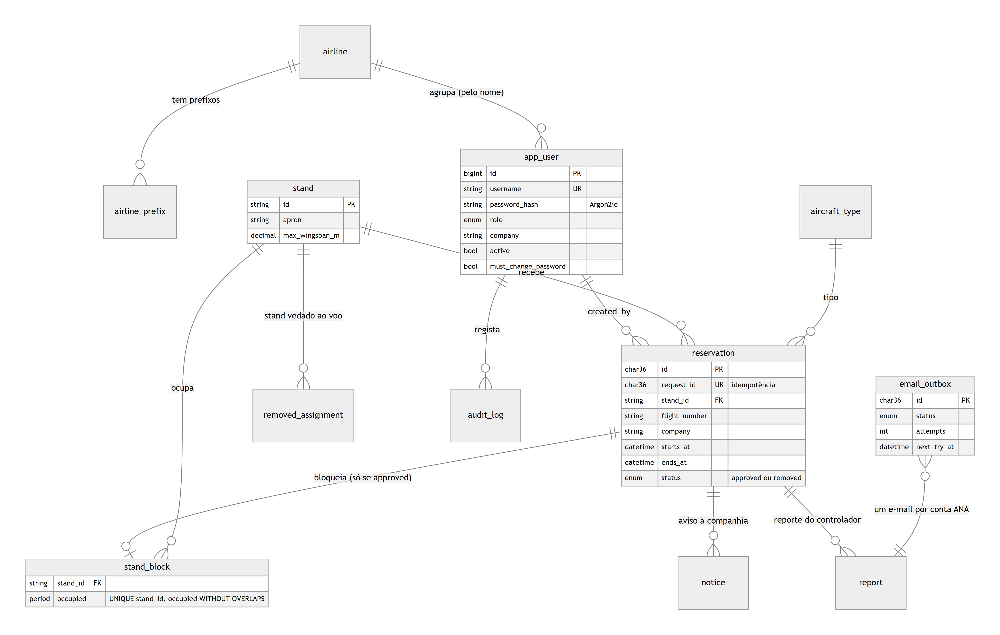
*Figura 13. Modelo de dados*

### g) Testes

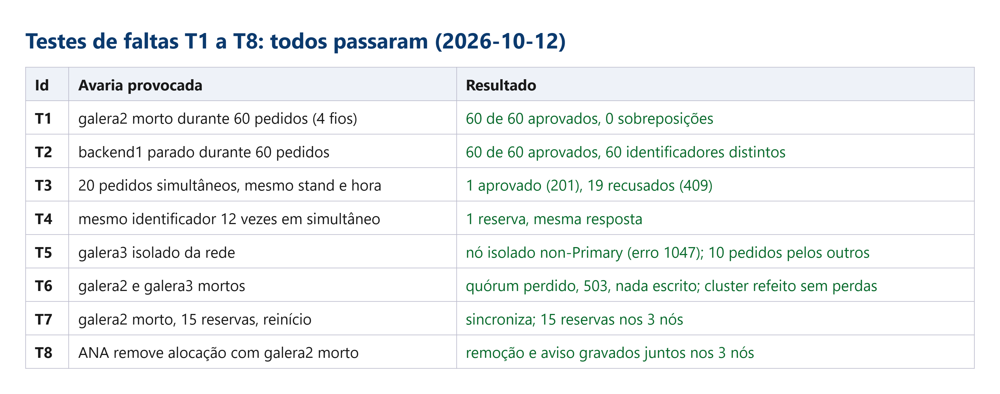
*Figura 14. Resultados dos testes de faltas T1 a T8*

### h) Produto final

As Figuras 3 a 8 mostram o produto final em funcionamento.

## Ficheiros técnicos

- **Arquitetura do sistema:** Figuras 9 e 10.
- **Diagramas UML:** casos de uso (Figura 1), componentes (Figura 10), sequência (Figuras 11 e 12), implantação (Figura 9) e estados (Figura 2).
- **Estrutura da base de dados:** Figura 13 e as migrações em `app/db/migrations/`.
- **Capturas da aplicação:** Figuras 3 a 8.
- **Documentação técnica:** `04_Documentacao_Tecnica/` (solver, spike de não sobreposição, testes de faltas, contas e companhias).
- **Repositório GitHub:** https://github.com/oastghost/PISTAS

## Anexos

### Anexo A. Glossário

- **Stand:** lugar marcado no aeroporto onde um avião fica parado para embarque, desembarque e preparação.
- **Despachante (dispatcher):** pessoa de uma companhia aérea que planeia os voos e trata dos pedidos operacionais, incluindo o stand.
- **ANA:** empresa que gere os aeroportos portugueses e decide o que pode ficar em cada stand.
- **Ground handler:** empresa que presta serviços ao avião em terra, como bagagem, passageiros e reboque (por exemplo, Menzies e Portway).
- **Controlador (ATC):** pessoa que dirige o tráfego aéreo. Na PISTAS só consulta e reporta.
- **CSP (problema de satisfação de restrições):** forma de resolver um problema dando as regras que a solução tem de cumprir e deixando um programa (o solver) encontrar uma solução. Na PISTAS, escolhe o stand de cada voo.
- **Docker (contentor):** forma de empacotar um programa com tudo o que precisa para correr, para o poder lançar em várias cópias.
- **Galera / quórum:** cluster de base de dados que replica os dados entre nós. Só aceita escritas enquanto a maioria dos nós se vê entre si.
- **Idempotente:** repetir o mesmo pedido tem o mesmo efeito que o fazer uma só vez.
- **Conflito:** duas reservas para o mesmo stand em horas que se sobrepõem.

### Anexo B. Modelo de faltas (resumo)

**Propriedade a proteger:** um stand nunca tem duas reservas sobrepostas, nem durante uma avaria. Entre "estar sempre disponível" e "nunca duplicar", a PISTAS escolhe não duplicar.

| Falta | Tratamento | Teste |
|---|---|---|
| Paragem de um nó da base de dados | Os backends passam a outro nó; maioria mantida | T1, T7 |
| Paragem de um backend | O nginx reenvia o pedido a outro backend; pedido idempotente | T2 |
| Pedidos simultâneos para o mesmo stand | A base de dados aceita um e recusa os outros | T3, T4 |
| Nó isolado da rede | Fica sem maioria, recusa escritas; os outros continuam | T5 |
| Dois nós em queda abrupta | Sem maioria, o nó restante recusa tudo (503); o cluster refaz-se quando os nós voltam | T6 |
| Remoção pela ANA durante uma avaria | Remoção e aviso gravados na mesma transação | T8 |
| Queda dos três nós | Recuperação com `recover.ps1`, arrancando o nó mais avançado | Manual |

Pressupostos: no máximo uma falha de nó em simultâneo para manter o serviço normal; falhas de paragem (crash) e omissão, não falhas bizantinas; sem partição de rede entre máquinas (tudo corre na mesma máquina). Detalhes em `04_Documentacao_Tecnica/testes-de-faltas.md`.

### Anexo C. Ficheiros de identidade

`PISTAS_logo.png` e `favicon.svg`, em `app/frontend/public/`.

 
